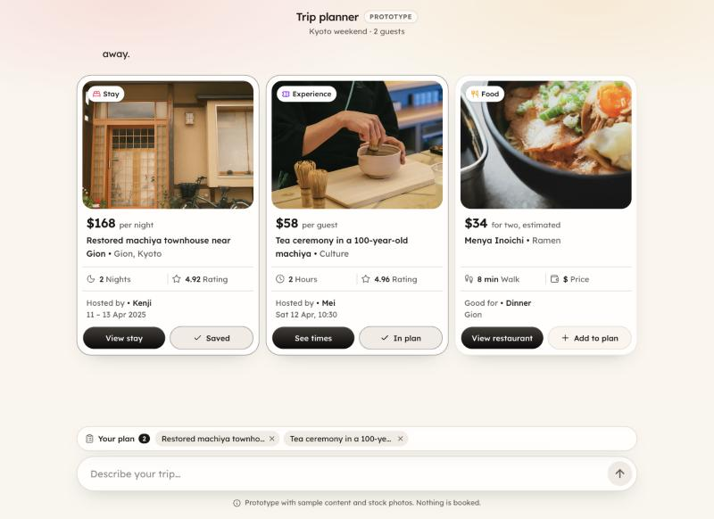

# Kyoto Trip Planner

**Live prototype:** <https://kyoto-trip-planner-ecru.vercel.app> ·
**Code:** <https://github.com/sahilux-com/kyoto-trip-planner>



Prototype of a conversational trip planner for a Kyoto weekend. It answers the
question "can travellers start exploring before configuring search filters?"
by letting them describe the trip in one message and getting three
recommendation cards back: a stay, an experience and a place to eat.

All content is sample data from the content pack. Nothing is booked, held or
checked against live inventory.

## Run it

```bash
npm install
npm run dev
```

Open <http://localhost:3000>, type a message (or tap one of the three starter
prompts) and press send.

1. **The chat locks.** The message box and send button are disabled, so a
   second request can't be typed or sent while one is in flight.
2. **A thinking state plays** for 1.6 seconds: animated dots, a status line and
   outlines of the three cards that are coming.
3. **The mock reply arrives:** three cards in the order Stay, Experience, Food,
   built from three rows of the content workbook (one stay row, one experience
   row, one food row), and the chat unlocks.

## Three use cases

The message is matched by its words to one of three sample weekends. Anything
that matches none of them gets the first one.

| Use case | Paste this | Pack rows |
|---|---|---|
| Culture and calm | Plan a weekend in Kyoto for two people. We enjoy cultural experiences, Japanese food and quiet neighbourhoods. | S1, E1, F1 |
| Food first | Plan a food-lover's weekend in Kyoto for two. We want market stalls, street food and a tasting walk with a local cook. | S3, E2, F3 |
| Hands-on | Plan a hands-on weekend in Kyoto for two. We'd like to make something in a pottery studio and stay somewhere calm by the river. | S2, E4, F2 |

## How it is put together

| Piece | Where |
|---|---|
| Kyoto weekend content workbook: the content pack spreadsheet transcribed as code, one sheet per card type | `src/data/kyoto-weekend-workbook.ts` |
| The three use cases, their starter prompts and the message matching | `src/data/trip-plans.ts` |
| Row-to-card mapping and the mock response builder | `src/data/mock-response.ts` |
| The single seam between the chat and "the assistant" (delay, mock, injected failure) | `src/lib/trip-planner.ts` |
| Chat page, thinking state, composer, error bubble, moderator control | `src/components/chat/` |
| The shared card layout and the three cards built on it | `src/components/cards/` |
| Card and error-state spec | [`docs/card-and-error-state-spec.md`](docs/card-and-error-state-spec.md) |

Stack: Next.js (App Router), React, TypeScript, Tailwind CSS v4. No backend.

## The cards

Stay, Experience and Food share one layout (`src/components/cards/card-parts.tsx`):
an inset photo with a badge, a price headline, a name line, two stats, a footer
row and two actions. The first (View stay, See times, View restaurant) opens
extra details inside the card; the second (Save, Add to plan) puts the card on
a **Your plan** shortlist shown above the message box. Nothing is booked.
Each card type maps its own content pack fields onto those slots. The three cards sit
side by side in one row; on a phone the row scrolls sideways. The badge and
its accent colour (coral, violet, amber) tell the cards apart.

## Error state

Open the page with `?moderator` on the address to get a **Fail next reply**
control in the top-right corner. It is one-shot: the next request waits 800 ms
and fails, the assistant shows an apology bubble with **Try again** and
**Browse stays**, and the control switches itself off. Try again re-sends the
same prompt and returns the three cards; the thread is never cleared.

`failure_injected`, `retry_success`, `card_opened` and `plan_added` are logged to the console and kept on
`window.__tripPlannerEvents`. Nothing is sent anywhere.

## Design and components

Lexend Deca throughout, on a warm paper background. UI primitives come from
shadcn/ui (button, badge, card, separator) and coss ui, formerly Origin UI
(skeleton, tooltip), in `src/components/ui/`.

## Photo credits

The cards use stock photos from [Unsplash](https://unsplash.com/license) for
illustration. They do not show the real stay, experience or restaurant.

Photographers and source links are listed per photo in
`src/data/stock-photos.ts`: Jazmin Wong, Yosuke Ota, rawkkim, Huy Phan,
Kate Wells, Sebastian Monroy, Stanley Kustamin, leongsan and Pratiksha Singh.
